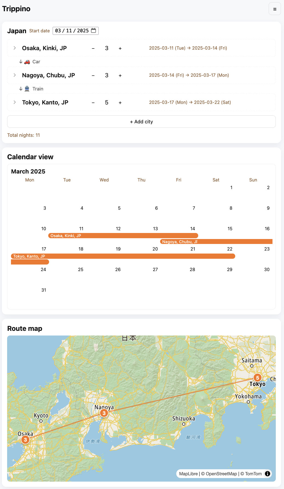

# Trippino

[](https://github.com/marcello-dev/trippino/actions/workflows/ci.yml)
[](https://nodejs.org/)
[](LICENSE)
[](https://github.com/marcello-dev/trippino/pulls)

Trippino is a website for planning simple trips. Check it out here: https://trippino.apivenue.com

It is built as a small single-node Express + SQLite demo app. It serves a static frontend from `app/public` and provides JSON APIs in `app/app.js`.

## Preview



## State management

As we don't always have internet connection when travelling, Trippino tries to work offline as much as it can.

The table below summarizes how the state (trips, cities, etc.) is managed.

|                               | Online                                                           | Offline                                                          |
| ----------------------------- | ---------------------------------------------------------------- | ---------------------------------------------------------------- |
| Anonymous user (unregistered) | State saved to device local storage only                         | State saved to device local storage only                         |
| First login user              | Local state is saved to remote database                          | Error                                                            |
| Logged in user                | Local and remote state in sync                                   | Read-only                                                        |
| Logged out user               | Local storage only, state is replaced with remote state on login | Local storage only, state is replaced with remote state on login |

## Quick start (development)

Requires Node.js 22.

1. Clone the repository and open a terminal in the project root.

2. Install dependencies:

```bash
npm install
```

3. Copy the example env file and edit it. Set the SMTP settings if you want to test email verification (Mailtrap, Ethereal, or another test SMTP provider works).

```bash
cp app/.env.example app/.env
```

| Variable             | Purpose                                                          |
| -------------------- | ---------------------------------------------------------------- |
| `PORT`               | Port the server listens on (the example uses 5000)               |
| `API_BASE`           | Public base URL, used in verification emails and by the frontend |
| `DATABASE_URL`       | Path to the SQLite file (defaults to `app/data.sqlite`)          |
| `SMTP_*`             | Outgoing email settings for account verification                 |
| `SKIP_EMAIL_SENDING` | Set to `true` to skip sending verification emails                |
| `TOMTOM_API_KEY`     | TomTom API key passed to the frontend                            |

The SMTP settings are `SMTP_HOST`, `SMTP_PORT`, `SMTP_USER`, `SMTP_PASSWORD`, `SMTP_FROM` and `SMTP_SECURE`.

4. Start the server (this loads `app/.env` and runs database migrations on startup):

```bash
npm start
```

5. Open the app in your browser: http://localhost:5000/ (or the port you set in `app/.env`).

## Development tasks

```bash
npm test          # run the Jest test suite
npm run migrate   # apply pending SQL migrations from migrations/
./format.sh       # format the codebase with Prettier
```

CI runs the tests and a Prettier check on every push and pull request to `main`.
